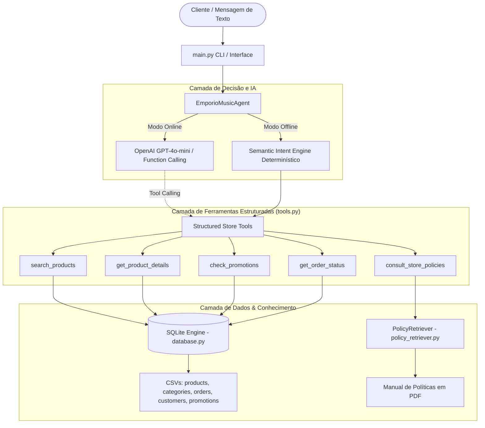

# 🎶 Empório da Música — Agente Inteligente de Atendimento

[](https://www.python.org/)
[](https://pytest.org/)
[]()
[]()
[]()

> Solução desenvolvida para o **Desafio Técnico — AI Engineer 2026 da Artefact**.  
> **Desenvolvido por**: **Gabriel Felippe Baptista** — *AI Engineer – Full-Stack para Aplicações com IA Generativa*.  
> Agente conversacional inteligente projetado para auxiliar a equipe da loja de instrumentos musicais **Empório da Música** (Campo Grande/MS), integrando catálogo em banco relacional, consulta de pedidos em tempo real, recuperação das políticas internas da empresa em PDF e tratamento elegante de escopo.

---

## 📌 Sumário
- [Visão Geral e Arquitetura](#-visão-geral-e-arquitetura)
- [Instalação e Configuração](#-instalação-e-configuração)
- [Como Executar](#-como-executar)
  - [1. Modo Offline (Sem necessidade de API Key)](#1-modo-offline-recomendado-para-avaliação-rápida-sem-custos)
  - [2. Modo Online (OpenAI API / LLM)](#2-modo-online-com-llm)
  - [3. Demonstração dos Cenários Avaliativos](#3-demonstração-dos-cenários-avaliativos)
  - [4. Testes Automatizados com Pytest](#4-testes-automatizados)
- [Justificativas das Decisões Técnicas](#-justificativas-das-decisões-técnicas)
  - [Matriz de Decisões Técnicas](#-matriz-de-decisões-técnicas)
  - [1. Framework(s) e Abordagem do Agente](#1-frameworks-e-abordagem-do-agente)
  - [2. Modelo e Provedor (LLM)](#2-modelo-e-provedor-llm)
  - [3. Interface de Interação](#3-interface-de-interação)
  - [4. Persistência do Histórico de Conversa](#4-persistência-do-histórico-de-conversa)
  - [5. Tratamento e Modelagem dos Dados](#5-tratamento-e-modelagem-dos-dados)
  - [6. Engenharia de Prompt, Persona e Escopo](#6-engenharia-de-prompt-persona-e-escopo)
- [Exemplos de Conversas](#-exemplos-de-conversas)
- [Limitações Conhecidas e Próximos Passos](#-limitações-conhecidas-e-próximos-passos)
- [Checklist de Conformidade com o Edital](#-checklist-de-conformidade-com-o-edital-artefact)
- [Workflow e Uso de Assistentes de IA](#-workflow-e-uso-de-assistentes-de-ia)

---

## 🏗 Visão Geral e Arquitetura

O sistema adota uma **arquitetura híbrida e desacoplada**:



### Estrutura de Diretórios
```text
├── data/                                 # Dados fornecidos pela loja
│   ├── desafio_tecnico_ai_eng - categories.csv
│   ├── desafio_tecnico_ai_eng - customers.csv
│   ├── desafio_tecnico_ai_eng - order_items.csv
│   ├── desafio_tecnico_ai_eng - orders.csv
│   ├── desafio_tecnico_ai_eng - products.csv
│   ├── desafio_tecnico_ai_eng - promotions.csv
│   └── políticas_da_loja.pdf
├── emporio/                              # Pacote principal da solução
│   ├── __init__.py
│   ├── agent.py                          # Agente com suporte Online (LLM) e Offline
│   ├── config.py                         # Gerenciamento de variáveis e caminhos
│   ├── database.py                       # Ingestão e consultas relacionais no SQLite
│   ├── policy_retriever.py               # Mecanismo de extração e retrieval do PDF
│   └── tools.py                          # Ferramentas formais e esquemas JSON
├── examples/                             # 5 diálogos completos de demonstração
│   ├── conversa_1_catalogo_orcamento.md
│   ├── conversa_2_endereco_horario.md
│   ├── conversa_3_consulta_preco_takamine.md
│   ├── conversa_4_politica_devolucao.md
│   └── conversa_5_fora_de_escopo_acessorios.md
├── tests/                                # Suíte de testes automatizados com Pytest
│   ├── test_agent.py
│   ├── test_database.py
│   ├── test_policy_retriever.py
│   └── test_tools.py
├── .env.example                          # Modelo de configuração de ambiente
├── .gitignore                            # Arquivos e diretórios ignorados pelo Git
├── main.py                               # Interface de linha de comando (CLI)
├── requirements.txt                      # Dependências Python
└── README.md                             # Documentação técnica completa
```

---

## ⚙ Instalação e Configuração

### Pré-requisitos
- **Python 3.10 ou superior** instalado.
- **Git** instalado.

### 1. Clonar o repositório
```bash
git clone https://github.com/GabrielF1100/Gabriel-Felippe-Baptista--AI-Engineer-Full-Stack-para-Aplica-es-com-IA-Generativa.git
cd Gabriel-Felippe-Baptista--AI-Engineer-Full-Stack-para-Aplica-es-com-IA-Generativa
```

### 2. Criar e ativar o ambiente virtual

**No macOS / Linux:**
```bash
python3 -m venv .venv
source .venv/bin/activate
```

**No Windows (PowerShell):**
```powershell
py -3 -m venv .venv
.\.venv\Scripts\Activate.ps1
```

### 3. Instalar as dependências
```bash
pip install -r requirements.txt
```

---

## 🚀 Como Executar

### 1. Modo Offline (Recomendado para Avaliação Rápida sem Custos)
O projeto foi cuidadosamente arquitetado com um **motor offline completo**, permitindo testar toda a lógica de negócio, catálogo de produtos, cálculo de estoque, descontos do PIX, frete e políticas da loja sem gastar créditos de API:

```bash
python main.py --offline
```
*Exemplo de perguntas para testar:*
- *"Quanto custa o Takamine GD20?"* (deve retornar R$ 2.199,00 e 5 unidades em estoque)
- *"Quais opções de violões disponíveis custando até R$1000?"*
- *"Qual o endereço da loja e o horário de atendimento?"*
- *"Me arrependi da minha compra, posso devolver meu pedido?"*
- *"Vocês vendem encordoamento de guitarra e palhetas?"* (testa a recusa educada de acessórios)

---

### 2. Modo Online (com LLM)
Para executar com o modelo de linguagem (`gpt-4o-mini` por padrão):

1. Copie o arquivo de exemplo para `.env`:
```bash
cp .env.example .env
```
2. Abra o arquivo `.env` e configure sua chave de API:
```env
OPENAI_API_KEY=sk-...
OPENAI_MODEL=gpt-4o-mini
OFFLINE_MODE=false
```
3. Execute o programa:
```bash
python main.py
```

---

### 3. Demonstração dos Cenários Avaliativos
Você pode disparar qualquer um dos cenários sugeridos no enunciado com um único comando:

```bash
# Executa todos os 5 cenários avaliativos em sequência:
python main.py --demo

# Ou executa um cenário específico (1 a 5):
python main.py --scenario 1  # Catálogo e orçamento (violões até R$ 1000)
python main.py --scenario 2  # Endereço e horários da loja física
python main.py --scenario 3  # Preço e estoque em tempo real (Takamine GD20)
python main.py --scenario 4  # Políticas de arrependimento e devolução (7 dias)
python main.py --scenario 5  # Gestão de escopo (acessórios e fora de contexto)
```

---

### 4. Testes Automatizados
A suíte de testes cobre todas as camadas do sistema (banco de dados, extração de PDF, execução de ferramentas e persona do agente):

```bash
pytest -v
```
*Resultado: **21 testes automatizados passando com 100% de sucesso.***

---

## 💡 Justificativas das Decisões Técnicas
(Em desenvolvimento)
